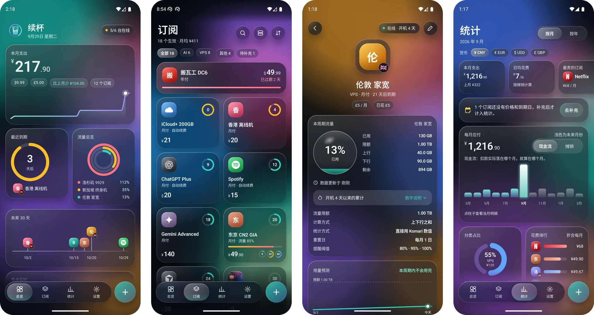
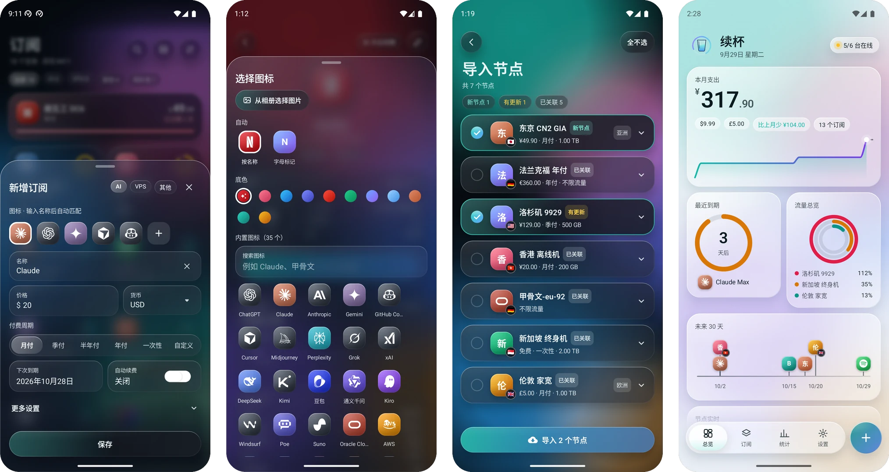

<div align="center">


# 续杯 Xubei

**订阅到期了吗？流量还剩多少？一眼看完。**

一个液态玻璃风格的 Android 订阅管理 app。
把 AI 服务、VPS 这些月付、季付、年付的订阅记在一起，到期前提醒你续杯，
还能从你自己的 [Komari](https://github.com/komari-monitor/komari) 面板读出每台 VPS 用了多少流量。


**[下载安装包](https://github.com/ftweg2/xubei/raw/main/release/xubei-1.0.apk)**

</div>





<div align="center"><sub>截图里都是演示数据</sub></div>

## 为什么做这个

订阅越来越多：ChatGPT、Claude、Cursor，再加上几台 VPS，有月付的、年付的，还有按流量算的。哪个快到期、这个月一共花了多少、哪台机器的流量快用完，散在各家的后台里。续杯把它们放到一个地方。

名字取自“续费”：杯子空了就续上。标志是一只盛着液体的玻璃杯，外面那圈没有闭合的环代表周期，和 app 里的到期环、流量环是同一个符号。

## 功能

**订阅**

- 记录月付、季付、半年付、年付、一次性购买和自定义天数的订阅，分 AI、VPS、其他三类。
- 到期前 7 天、3 天、1 天和当天提醒，可以自己改。续费后一键标记，下次到期日自动顺延。
- 几十个内置服务图标，输入名称自动匹配（“GPT”“ChatGPT Plus”都认得出是 ChatGPT）。匹配不到的用字母标记，也可以从相册选图。

**VPS 流量**

- 连接你自己的 Komari 面板，节点的价格、周期、到期日、流量限额一键导入，不用手填。
- 每台机器显示已用流量、上下行、限额、本周期剩余，并预测这个周期会不会用完。
- 用量到 80%、95%、100% 时提醒。
- 总览里能看到每台机器是否在线和实时网速。
- 默认用访客模式读取面板，不需要填 API Key。

**统计**

- 本月支出、日均花费、比上月多了还是少了、全年预估。
- 每月应付柱状图，支持“现金流”和“摊销”两种算法。
- 分类占比、花费排行、缴费日历、未来 90 天时间轴、各台 VPS 流量对比。
- 多种货币分开统计，不做汇率换算。

**界面**

- 液态玻璃：流动的色彩背景，颜色随到期和流量状态变化；悬浮的玻璃导航栏，标签是一颗可以拖动的液滴；玻璃弹层和对话框边缘有折射。
- 十二种图表全部自己用 Canvas 画，没有用图表库。
- 深色、浅色、跟随系统三种主题。系统关闭动画时，所有动画直接跳到终态。

**隐私**

- 没有账号，没有服务器，没有统计上报。数据只存在手机里。
- 手机只和你自己填的 Komari 面板通信。API Key 是可选的，填了会用系统密钥库加密保存，并且不进系统备份。
- 支持导出和导入 JSON 备份。

## 安装

下载 [xubei-1.0.apk](https://github.com/ftweg2/xubei/raw/main/release/xubei-1.0.apk)（约 2.9 MB），在手机上打开安装。第一次安装时系统会问是否允许安装未知来源的应用，允许即可。也可以自己构建，见下面的[构建](#构建)。

最低 Android 8.0（API 26）。Android 13 及以上有完整的玻璃效果，更低的版本会自动降级，见[玻璃效果和系统版本](#玻璃效果和系统版本)。

界面只有中文。

## 致谢

- 玻璃效果来自 [Kyant0/AndroidLiquidGlass](https://github.com/Kyant0/AndroidLiquidGlass)和 [Kyant0/Shapes](https://github.com/Kyant0/Shapes)。
- 流量数据来自 [Komari](https://github.com/komari-monitor/komari)。
- 服务图标来自 [simple-icons](https://github.com/simple-icons/simple-icons)、[lobe-icons](https://github.com/lobehub/lobe-icons)、[dashboard-icons](https://github.com/homarr-labs/dashboard-icons)。各品牌的名称和标志归各自的公司所有，这里只用来标识对应的服务。

完整的来源和许可证见 [THIRD_PARTY_NOTICES.md](THIRD_PARTY_NOTICES.md)，app 里在“设置 → 关于续杯 → 开源许可”。

---

下面是详细说明。

## 界面结构

底部是一条悬浮的玻璃导航栏，四个标签，旁边一颗独立的玻璃加号（新增订阅，从加号处长出玻璃弹层）。往下滚动时导航栏缩小，往上滚动时恢复。

| 标签 | 内容 |
|---|---|
| 总览 | 便当盒网格：本月支出（大数字、其他货币胶囊、比上月、支出节奏曲线）、最近到期环、流量同心环、未来 30 天时间轴、节点实时网速、分类占比、全年预估；下拉刷新（杯子指示器：下拉越多液面越高，松手后环开始转动，刷新时头部标志的液面升高，完成后回落） |
| 订阅 | 分类筛选胶囊、搜索、方块和列表两种视图、三种排序；最先到期的置顶；长按弹出玻璃菜单（编辑、续费、归档、删除） |
| 统计 | 关键指标（本月或本年支出、日均花费、最贵的订阅、比上期、累计已花、生效的订阅）；每月应付柱状图（现金流或摊销，点柱子看当月明细）；按年视图；分类占比环；花费排行；缴费日历；各台 VPS 流量对比；未来 90 天时间轴；多种货币分开统计 |
| 设置 | 玻璃分组列表：Komari 监控、提醒、后台刷新、外观、显示、数据、调试（调试版）、关于 |

标签下面的页面：订阅详情（沉浸式头部、流量液面环、用量预测、实时、节点信息、近期用量、历史周期、到期环、累计花费）、Komari 面板设置、节点导入、关于、开源许可、玻璃与图表调试页（调试版）。新增和编辑订阅是一块厚玻璃弹层，不是单独的页面。

### 玻璃效果和系统版本

| 系统版本 | 效果 |
|---|---|
| Android 13 及以上 | 完整效果：背景模糊、悬浮玻璃（导航栏、加号、弹层、对话框）边缘的折射、高光边 |
| Android 12 | 模糊和高光，没有折射 |
| Android 11 及以下 | 半透明着色玻璃加高光边，没有模糊 |

为了滚动流畅，页面里的玻璃面板只着色不模糊（背后只有柔和的色彩背景），也不做饱和度增强，只有真正盖在内容上的玻璃（导航栏、加号、弹层、对话框、提示条、二级页面的顶栏）才模糊和增强色彩。

### 外观设置

“设置 → 外观”里有：

- **主题**：跟随系统、深色、浅色。默认深色。
- **降低透明效果**：玻璃改为几乎不透明、不模糊，文字对比更高，也更省电。
- **背景动画**：关闭后流动的色彩背景静止不动（系统关闭动画时本来就是静止的）。

调试版在“设置 → 调试 → 玻璃与图表调试页”里还可以强制使用 Android 12 或 Android 11 的玻璃效果，查看全部图表和服务图标。

### 服务图标

每个订阅的图标按名称自动匹配内置的服务图标（ChatGPT、Claude、Gemini、Copilot、Cursor、甲骨文、AWS、Vultr、阿里云、腾讯云、iCloud、Netflix 等几十个）：

- 不区分大小写，忽略空格、标点和全角字符；支持别名和中文名，例如“ChatGPT Plus”“GPT”都匹配 ChatGPT，“甲骨文”“OCI”都匹配 Oracle。
- 三个字母以内的简写只匹配完整的词（“GPT-4”能匹配，“Cloudflare”不会被当成“cf”）。
- 匹配不到时显示字母标记：名称的首字母或首个汉字，配一个由名称算出来的固定颜色，同一个名称永远是同一个颜色。
- VPS 的图标角上叠加 Komari 节点的国旗。

自定义：在编辑弹层的“图标”一行点“＋”，可以选任意内置图标、改颜色、改用字母标记，或者从相册选一张图片。选过之后不再自动匹配，改回“自动”即可恢复。

### 统计页的两种口径

每月应付的柱状图可以在“现金流”和“摊销”之间切换：

- **现金流**：扣款实际落在哪个月，就算在哪个月。年付的订阅只在扣款那个月出现一整笔，其他月份是 0。
- **摊销**：把一笔付款平摊到它覆盖的时间里。按月计的周期（月付、季付、年付……）每个月算一份（年付 ¥1200 每月 ¥100）；按天计的自定义周期按天数比例分到各月。一次性购买和长期有效的订阅不参与摊销。

两种口径一年加起来相同，只是分布不同。几点约定：

- 过去的月份按“每期都在到期日付过款”推算（和总览一致）；“累计已花”从每个订阅添加到 app 的那天起算，包含已归档的订阅。
- 一次性购买和付费的长期有效订阅，在现金流里算在添加到 app 的那一天。
- 免费、已归档、还没有价格和到期日（待补充）的订阅不计入。
- 每种货币分开统计，不做汇率换算；有多种货币时用顶部的货币胶囊切换。

## 构建

需要 Android Studio（或命令行）和 Android SDK，JDK 由 Gradle 工具链自动准备。

```bash
# Windows
.\gradlew.bat :app:assembleRelease               # 正式包：app/build/outputs/apk/release/app-release.apk
.\gradlew.bat :app:assembleDebug                 # 调试包：app/build/outputs/apk/debug/app-debug.apk
.\gradlew.bat :app:testDebugUnitTest             # JVM 单元测试
.\gradlew.bat :app:lintDebug                     # Lint
.\gradlew.bat :app:connectedDebugAndroidTest     # 仪器测试（需要一台模拟器或真机；跑完会卸载 App）

# macOS / Linux 把 .\gradlew.bat 换成 ./gradlew
```

装到手机上用的必须是正式包。调试包的代码全部解释执行，在真机上会明显卡顿，只用于开发。

- `release`：不可调试，开启 R8 和资源压缩。签名见下面的“签名”。
- `perf`：和 `release` 完全一样，只是包名多了 `.perf` 后缀，并带上 `src/devtools` 里的开发钩子（固定时钟和数据）。可以和正式版同时装在一台设备上，用于测量和截图对比。

### 签名

Android 只允许用同一个密钥签名的安装包覆盖安装。密钥不同就只能卸载重装，数据会丢。

- 仓库里发布的安装包用作者的正式密钥签名。密钥和密码放在 `signing/` 目录（`xubei-release.jks` 和 `keystore.properties`），这个目录不进版本库。
- 没有 `signing/keystore.properties` 时，`release` 构建会改用本机的调试密钥（`~/.android/debug.keystore`）签名。所以克隆仓库后可以直接构建，但你构建出来的包不能覆盖安装仓库里发布的包，反过来也一样。
- 想用自己的密钥：建一个 `signing/keystore.properties`，写上 `storeFile`（相对 `signing/` 的文件名）、`storePassword`、`keyAlias`、`keyPassword` 四项。

技术栈：Kotlin、Jetpack Compose + Material 3、Navigation Compose、Room（KSP）、DataStore、WorkManager、OkHttp + kotlinx.serialization。依赖注入是手写的 `AppContainer`。

## 连接 Komari

1. 打开“设置 → Komari 监控 → 面板连接”。
2. 填写面板首页地址，例如 `https://status.example.com`，或自建面板常见的 `http://203.0.113.10:25774`。末尾的 `/` 或 `/api` 会自动去掉。
3. API Key 可以不填。公开面板用访客模式就能读取节点和流量；只有开启了“私有站点”或需要读取隐藏节点时才需要 Key。**Komari 的 API Key 权限等同管理员**，续杯会用 Android Keystore 加密保存，不写日志、不进系统备份、不进导出文件；地址是 HTTP 时填 Key 会提示明文传输风险。
4. 点“测试连接”，看到版本号和节点数后保存。
5. 点“导入节点”，勾选要导入的机器。面板里填了价格、周期、到期日、流量限额的节点会直接带过来；没填的会标记为“待补充”，不计入支出，也不发到期提醒，之后可以在 App 里补。
6. 回到总览下拉刷新，就能看到流量。之后在“设置 → 立即同步”可以再次从面板同步价格和到期日。你在 App 里手动改过的字段会被锁定，同步不会覆盖；在编辑页可以解锁。

续杯只调用三个只读接口：`GET /api/version`、`GET /api/nodes`、`GET /api/recent/{uuid}`，不会修改面板上的任何数据。总览页在前台时每 10 秒读一次 `/api/recent/{uuid}` 画“节点实时”，离开总览或 app 进入后台就停止；这些实时数据不保存。节点的 `region`（国旗）在导入和同步时保存，显示在 VPS 图标的角上。

面板上已经永久消失或长期离线的节点，在订阅详情页会显示“解除关联”，解除后订阅和历史周期都保留。

## 两种流量统计方式

每台 VPS 都可以在编辑页的“统计方式”里二选一。

| | 直接用 Komari 数值（方式一，默认） | App 自己累计（方式二） |
|---|---|---|
| 数字从哪来 | Komari agent 上报的累计值 | App 每次刷新读一次计数器，把两次读数之差加到本周期 |
| agent 没开 `--month-rotate` | 是**开机以来**的累计，重启归零，不按月清零 | 按你设的重置日每月归零，适合这种机器 |
| agent 开了 `--month-rotate` | 就是本月重置日以来的累计，**最准确** | 不推荐，App 会提示改用方式一 |
| 精度 | 和面板一致 | 取决于刷新频率；两次刷新之间机器重启，重启前那一段会漏算；系统省电推迟后台刷新时漏算风险更大 |
| 期初已用量 | 不需要 | App 只能从开始统计的那一刻算起。本周期之前已经用掉的流量，请在编辑页填“期初已用量”，已用量 = 期初已用量 + App 累计的增量 |

建议：

- 能改 agent 启动参数的机器，加上 `--month-rotate`，然后用方式一。再在 VPS 设置里打开“agent 已开启按月统计”，流量卡会显示“本月 N 号以来的累计”。
- 改不了 agent 的机器，用方式二，并把后台刷新间隔调短一些（设置 → 流量刷新间隔）。

方式二的细节：

- 计数器变小，或 `uptime` 变小（机器重启），判定为计数器重置，这次的增量取当前读数。
- 重启了但计数器没有变小，说明计数器是持久的（`--month-rotate` 的统计保存在 agent 的文件里），按普通差值计算，不会把整月重复计入。
- 一个很大的计数器只小幅回落（不超过 10%），按“agent 重启丢了最后几分钟没保存的数据”处理，不当作重置。
- 跨过重置日的那一次增量按时间比例拆到两个周期。重置日按“设置 → 重置时区”的零点切换。
- 每次刷新的原始读数保存 90 天，用于详情页的“近期用量”趋势图。

### 给 agent 加 `--month-rotate`

`--month-rotate N` 表示每月 N 号起重新累计（N 通常填服务商的账单日）。以 Linux 上用 systemd 安装的 agent 为例：

```bash
# 找到 agent 的服务文件（常见路径，以实际为准）
systemctl cat komari-agent

# 编辑 ExecStart 这一行，在已有参数后面加上 --month-rotate 1
sudo systemctl edit --full komari-agent
#   ExecStart=/opt/komari/agent -e https://status.example.com -t <token> --month-rotate 1

sudo systemctl daemon-reload
sudo systemctl restart komari-agent
```

用 Docker 运行的 agent，在容器命令最后加上 `--month-rotate 1` 后重新创建容器。

注意：

- 开启后计数器会从当前的“开机以来累计”降到很小的值，这是正常的；之后数字是“本月 N 号以来的累计”（实际从开启的那一刻开始计）。
- agent 把按月统计保存在工作目录的 `net_static.json` 里（每 10 分钟写一次），重启 agent 或重启机器后不会归零。
- App 里请把这台 VPS 的“流量重置日”设成和 N 相同，统计方式选“直接用 Komari 数值”，并打开“agent 已开启按月统计”。

## 提醒和后台刷新

- 通知分两个渠道：到期提醒、流量提醒。第一次保存带到期日的订阅后，App 会先用自己的说明页解释用途，再申请通知权限（Android 13 以上）。拒绝后可以在“设置 → 通知”里查看状态并跳到系统设置。
- 到期提醒默认在到期前 7、3、1 天和当天各一次（设置里可改，单个订阅可以单独设置）；手机关机错过的提醒会在下一次检查时补发一次。同一条提醒只发一次；续费后新的到期日重新计。
- 流量提醒按每台 VPS 的阈值（默认 80%）触发，另外在 95% 和 100% 各提醒一次；按周期去重，新周期重新计。不限流量的 VPS 不提醒。
- 后台刷新用 WorkManager：流量刷新默认每 30 分钟（可选 15 分钟到 6 小时，或关闭），需要联网；到期检查每天 9 点左右一次，不需要网络，同时把过期的自动续费订阅顺延到当前周期。
- 部分手机会限制 App 在后台运行，提醒可能推迟。“设置 → 后台刷新”里有跳到系统电池优化设置的入口（App 不申请“忽略电池优化”权限）。
- 调试版在“设置 → 调试”里有“立即检查提醒”“立即后台刷新”两个入口，发布版不显示。
- 同一次检查找到多条提醒时，先逐条发出各条通知（相邻两条至少间隔 0.25 秒），最后更新一次分组摘要，避免系统因为发送太快丢弃摘要的更新。

## 导出和导入

“设置 → 数据”可以把全部订阅导出为 JSON 文件（默认文件名 `xubei-backup-日期.json`），或从这样的文件导入。改名前导出的 `vluer-subscriptions-日期.json` 照样能导入（文件内容的格式标识仍是 `vluer-subscriptions`，新旧文件通用）。导出内容包含订阅和 VPS 设置（节点关联、限额、统计方式等），**不包含** API Key、面板地址、流量读数和通知记录。导入前会显示将导入多少条；已经存在的订阅会跳过，被其他订阅占用的节点关联不会恢复。

## 本地模拟面板

`tools/mock-komari/` 里有一个只依赖 Python 标准库的模拟面板，用来在模拟器里测试，不需要真实的服务器：

```bash
python tools/mock-komari/mock_komari.py          # 监听 127.0.0.1:8765
```

模拟器里填 `http://10.0.2.2:8765`。数据在 `tools/mock-komari/mock_data.json`，每次请求都会重新读取：改 `totalUp` / `totalDown` 模拟流量增长，把计数器和 `uptime` 改小模拟重启，`"offline": true` 模拟离线，也可以加 `grow_up_per_min` / `grow_down_per_min` 让计数器自动增长。更多用法见 [tools/mock-komari/README.md](tools/mock-komari/README.md)。

## 标志和启动画面

标志是一只盛着液体的玻璃杯，外面一圈没有闭合的环（设计稿 `docs/mockups/logo-xubei.html`）。启动图标是带底色的自适应图标（背景层、前景层、Android 13 的主题图标层），通知栏用白色单色版。

- 启动画面：系统先显示空杯子和一圈淡淡的底环，App 画出第一帧后接着播放：环顺时针画出，液面从杯底升到正常高度，晃动两三下后静止，然后淡出到总览页。系统关闭动画时直接显示总览页。
- 启动画面的深浅色跟随 App 里的主题设置（Android 13 及以上）；Android 12 及以下由系统在 App 启动前绘制，只能跟随系统的深色模式。
- 总览页头部的标志进入页面时液面晃一下，下拉刷新时液面升高，刷新完成回落。测试连接成功时杯子被注满、环闭合。
- 浅色模式下杯身描边和高光改用深色，环和液体颜色不变。

## 数据库和升级

数据库文件是 `vluer.db`（改名后文件名保持不变，否则已有数据会丢）。表结构版本 1 是正式基线，导出在 `app/schemas/com.ftwegc.myapplication.data.local.AppDatabase/1.json`，identityHash 是 `97fcafdc3bbb05830ef9bbdede01ea71`。以后任何更新都不能让已有数据读不出来。

### 改表结构的流程

加列、删列、改类型、加索引、加表、改实体里的字段名，都算改表结构。

1. 把 `AppDatabase.VERSION` 加 1（例如 1 → 2）。
2. 写一个 `Migration(1, 2)`，用 SQL 把旧表改成新结构并保留数据，加进 `AppDatabase.MIGRATIONS`。每一步版本都要有迁移（1 → 2、2 → 3 …）。
3. 构建一次。KSP 会导出新的 `2.json`，`1.json` 不会被改动；已发布版本的 schema 文件永远不要改、不要删。
4. 在 `SchemaVersionTest.RELEASED` 里加上 `2 to "<2.json 里的 identityHash>"`。已有的记录不要改。
5. 写迁移测试：用 Room 的 `MigrationTestHelper`（`room-testing` 已在依赖里）从 `1.json` 建库、插入数据、跑迁移、检查数据。第一次写时需要在 `app/build.gradle.kts` 里把 `app/schemas` 加进 androidTest 的 assets。
6. 在装着旧版本和数据的模拟器上用 `adb install -r` 覆盖安装，确认数据还在。

`SchemaVersionTest`（JVM 单元测试）守着这条规则：表结构变了而版本号没变时，它会失败并说明该怎么做；它也检查已发布的 schema 文件没被改动、每一步版本都有迁移、版本号没有往回改。

### 旧测试版留下的数据

打开数据库时，如果 Room 发现文件的版本号和当前一致、但表结构的 identityHash 不一致（开发期间直接改过表结构的测试版留下的数据），App 不会闪退：

- 旧文件改名保留在 App 私有目录 `databases/` 下，例如 `vluer-incompatible-20260929-101530.db`（连同 `-wal`、`-shm`），不删除；
- 新建空数据库，App 正常打开；
- 打开后用一个玻璃对话框说明一次：检测到旧版本的测试数据，结构不兼容，已另存备份，现在是空白状态；
- 设置（DataStore）不受影响，Komari 面板地址和 API Key 都保留。

只处理这一种情况。数据库版本比 App 新（装回旧版）、缺少迁移、文件损坏等其他情况保持 Room 的默认行为。需要取回备份时（调试版）：

```bash
adb shell run-as com.ftwegc.myapplication ls databases
adb exec-out run-as com.ftwegc.myapplication cat databases/vluer-incompatible-20260929-101530.db > old.db
```

## 已知限制

- 方式二的精度取决于刷新频率；两次刷新之间机器重启会漏算；国产 ROM 的后台限制会推迟刷新。
- 改了流量重置日后，当前周期从新的重置日开始重新计，之前已经累计的部分留在上一个周期里，必要时请重新填写期初已用量。
- App 无法探测 agent 是否开了 `--month-rotate`，只能根据读数猜测（重启后计数器没归零，或没重启就归零），并由用户在 VPS 设置里确认。
- 每次安装后，第一次打开“新增订阅”和第一次点进订阅详情会卡一下，之后不再出现。这是代码和着色器首次运行的开销。
- 只支持一个 Komari 面板；不做汇率换算、云同步、桌面小组件、英文界面。
- 面板在 Cloudflare 质询或登录页后面时会返回 HTML，App 会提示“地址可能不是 Komari 面板”。
- 开发期间的测试版改过表结构而没有提升版本号。装过这种测试版的设备覆盖安装后，旧数据读不出来，会另存为备份并从空白开始（见下面“数据库和升级”），不会闪退；备份里的数据 App 不会自动恢复。

## 许可证

代码以 [MIT 许可证](LICENSE) 发布。第三方代码和图标各有自己的许可证，见 [THIRD_PARTY_NOTICES.md](THIRD_PARTY_NOTICES.md)。各品牌的名称和标志归各自的公司所有。
